# pomo



A minimal 50/10 pomodoro timer in the macOS menu bar. It shows 🍅 when idle, `🍅 49:59` while you work and `☕ 09:59` during a break, and loops until you stop it. Every phase change sends a notification and plays the Glass sound.

The countdown is computed from a stored end time, so it stays correct after sleep and continues after a restart.

Requires macOS 14 or newer.

## Use

Click the 🍅 in the menu bar and choose Start. The menu shows the current session, for example "Session 3: Focus". Stop ends the loop and resets the count. Launch at Login starts Pomo automatically when you log in (works once the app is in /Applications). On first launch macOS asks whether Pomo may send notifications: allow it.

## Build

Only the Command Line Tools are needed, Xcode is not.

```sh
scripts/build.sh           # builds build/Pomo.app, signed ad hoc
cp -R build/Pomo.app /Applications/
scripts/test.sh            # runs the tests
```

`scripts/make-icon.sh` regenerates the app icon. `pomo.sh` is the original shell version of the timer.
